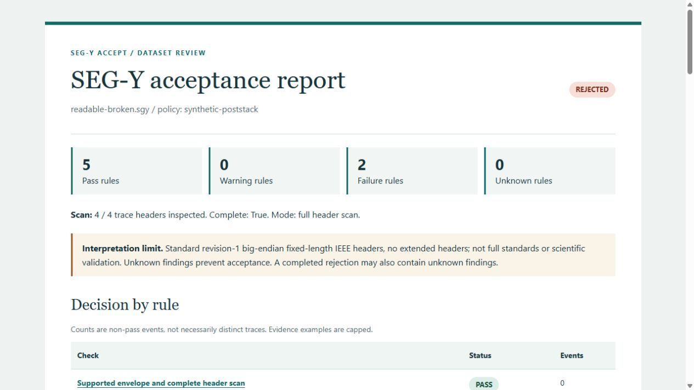

# segy-accept

**Explain whether a SEG-Y dataset meets a declared receiving workflow.**

A file can open successfully while its sampling headers disagree or its post-stack
grid contains duplicate and missing cells. This read-only auditor turns those
contradictions into reproducible JSON findings and a self-contained HTML report.

The first version supports **revision 1.0, big-endian, fixed-length IEEE-float
traces, with no extended textual headers**. It checks standard CDP X/Y and
inline/crossline fields. It is a workflow acceptance tool, not a full SEG-Y
standards validator, seismic viewer, amplitude checker, or CRS inference engine.
Sampling count and interval use the revision-1 positive signed 16-bit range,
1-32767; unsigned vendor extensions are outside this receiving profile.

## Try the synthetic demonstration

Use Python 3.12 (verified locally on Windows). Python 3.10+ is declared in the
package; the included CI matrix is prepared, but has not run on GitHub yet.

```sh
python -m venv .venv
# Activate the environment: .venv\Scripts\Activate.ps1 on Windows,
# or source .venv/bin/activate on macOS/Linux.
python -m pip install -e ".[dev]"
python -m segy_accept demo demo-output
```

Open `demo-output/readable-broken/audit.html`. The demo creates seven tiny,
explicitly synthetic files and reports, plus a policy and expected-results manifest.
The destination must be new. No data download, account, GPU, or server is needed.

[Open the checked-in sample report](examples/sample-report.html) or
[inspect its JSON findings](examples/sample-report.json).



| Example | Expected outcome | What it demonstrates |
| --- | --- | --- |
| clean | accepted | Every implemented rule agrees with the declared policy |
| readable-broken | rejected | Readable file, inconsistent sampling, duplicate and missing grid cells |
| outside-bounds | rejected | Correctly scaled coordinate violates declared bounds |
| unknown-units | incomplete | Plausible numbers do not establish coordinate units |
| missing-cell | rejected | File is intact, but the receiving grid is incomplete |
| truncated | incomplete | Structural failure prevents a full scan |
| unsupported-revision | incomplete | Revision-2 input is outside this tool's support profile |

## Audit a local file

```sh
segy-accept audit survey.sgy --policy examples/policy.json --out reports/survey
```

Edit the example policy to describe your actual workflow. Its reference is
synthetic and must not be treated as a real survey CRS.

```json
{
  "schema_version": 1,
  "name": "synthetic-poststack",
  "version": "1",
  "sample_interval_us": 2000,
  "samples_per_trace": 8,
  "coordinates": {
    "units": "metres",
    "reference": "Synthetic local grid, not a real CRS",
    "bounds": [900, 1100, 1900, 2100]
  },
  "grid": {"inlines": [10, 11], "crosslines": [20, 21]}
}
```

`bounds` are inclusive `[xmin, xmax, ymin, ymax]`, applied **after** scalar
arithmetic. Coordinate units are `metres`, `feet`, or `decimal_degrees`.
For length units, the binary measurement-system word must agree. Grid means
one trace per Cartesian inline/crossline pair, appropriate only when that is
your declared post-stack expectation. Missing bins are not inherently bad in
every survey. Unknown keys and duplicate JSON keys are errors.

The report records input SHA-256, a canonical/default-expanded policy SHA-256,
tool and reader versions, complete/expected/inspected trace counts, stable rule
IDs, bounded evidence examples, and next steps. No timestamp or absolute path
is embedded, so an unchanged input/policy/environment gives unchanged output.

### Decisions and exit codes

| Code | Meaning |
| --- | --- |
| 0 | Accepted by all implemented rules; warnings may remain |
| 1 | Completed audit found a policy contradiction |
| 2 | Incomplete knowledge: unsupported input, incomplete scan, or unknown finding |
| 3 | Invalid invocation/policy, input I/O error, or report-output error |

A completed rejection can contain unknown findings. Missing policy dimensions
are **unknown**, not disabled passing checks. To reach acceptance, declare both
sampling expectations, coordinate expectations, and the expected grid.

Existing reports are preserved unless `--overwrite` is supplied. Report targets
that alias the input or policy are refused, including hardlinks. Do not modify
input files or report directories concurrently with an audit.

## What distinguishes this experiment

[segyio](https://github.com/equinor/segyio) supplies the reader;
[SEG-Y-SAK](https://trhallam.github.io/segysak/latest/examples/example_segy_headers.html)
already provides header scanning and summaries. This project adds a small,
explicit receiving-policy contract, reproducible failures, evidence, and next
steps. Its usefulness is a hypothesis demonstrated on synthetic cases; no
industrial adoption or uniqueness is claimed. See [decisions and sources](docs/decisions.md).

## Verification and limits

```sh
python -m pytest --cov=segy_accept --cov-report=term-missing
python -m ruff check .
python -m ruff format --check .
python -m build
```

[Rules](docs/rules.md) explain each check. [Validation](docs/validation.md)
describes the independent byte-level fixtures, tested environment, and remaining
work. `.github/workflows/ci.yml` is ready for a repository push; no remote
repository has been created by this implementation.

Every trace header is scanned; payload amplitudes are not inspected. Global grid
checks use O(unique cells) memory. The initial guards are 2 GiB per file,
1,000,000 traces, 1,000,000 expected cells, and 1 MiB per JSON policy.
These are safety limits, not measured capacity or performance promises.
The size guard skips hashing oversized inputs and reports a null hash.

Zero coordinate scalar is treated as unity **with a warning**, a documented
receiving convention rather than an assertion of full revision-1 conformance.
Unrecognized scalars are failures; they cannot establish trusted bounds.
No repairs or unit conversions between incompatible bases are performed.

## Licence

Original code and generated synthetic fixtures: [MIT](LICENSE).
segyio is a separate LGPL-3.0 dependency; NumPy has its own BSD licence and bundled
dependency notices. Installing this package does not relicense those components.
No third-party field data are bundled.
